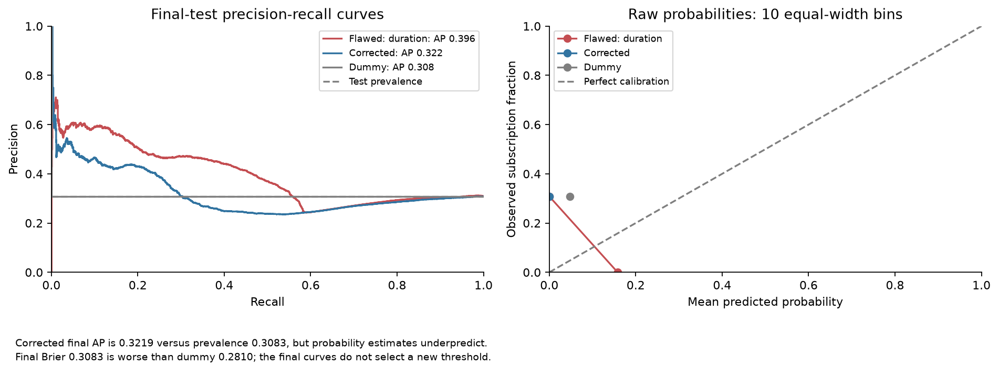
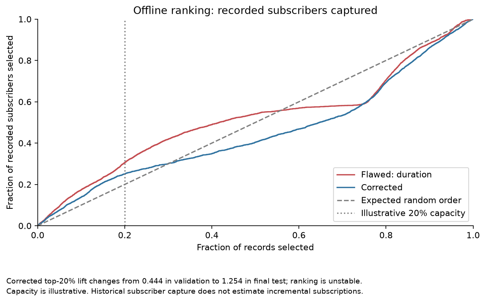

# Bank marketing leakage review

Can a model identify likely term-deposit subscribers before calling them? This project compares two fixed logistic regressions on identical chronological record blocks. The deliberately flawed model includes completed call duration; the corrected model removes that unavailable input.

**The corrected model is not ready for call prioritisation under this protocol.** Its validation average precision is **0.0949**, below prevalence **0.1107**. Final average precision improves modestly to **0.3219** against **0.3083**, but final Brier score **0.3083** is worse than the dummy's **0.2810**. At threshold 0.5, both fitted models select zero positives and miss all **2,540** final-test subscribers.



Removing duration fixes a known timing flaw. It does not resolve the change in subscription prevalence from **4.81%** in training to **30.83%** in final test, or the severe probability underprediction: the corrected model's maximum final probability is only **4.44%**. An illustrative top-20% ranking also changes from lift **0.444** in validation to **1.254** in final test.



## Analysis and decision

Open [bank_marketing_leakage.ipynb](bank_marketing_leakage.ipynb). It leads with the decision and measured failure verdict, then examines drift, feature timing, the controlled comparison, probability and threshold failure, capacity instability and the next decision. Every graph has an adjacent interpretation and an exported caption; technical choices follow in the appendix.

- Preserve the 41,188 original records, `unknown` categories and exact duplicates. Treat `pdays == 999` as no prior contact, with a derived indicator and training-imputed recency.
- Use the supplied order: 24,712 training records, 8,238 validation records and 8,238 final-test records. Exact dates and customer IDs are unavailable, so these are chronology proxies and cannot prove customer separation.
- Fit both logistic regressions on training only with identical fixed settings. The pair differs only by duration. Both exclude other ambiguous current-contact fields; retained customer/history/economic inputs have explicit availability assumptions.
- Compare accuracy, precision, recall, average precision, Brier score and confusion counts with a training-prevalence dummy. Inspect a fixed 0.5 threshold and an illustrative top-20% capacity without retuning against the final outcomes.

Duration raises final average precision by **0.0742**, but it does not exist before the call. The recommendation is to investigate drift and verify customer snapshots and economic release vintages using fresh forward data before any pilot, recalibration or threshold selection. Historical subscriber capture does not estimate incremental subscriptions, call-cost savings or ROI.

## Data and stack

The bundled `bank-additional-full.csv` comes from [UCI Bank Marketing](https://archive.ics.uci.edu/dataset/222/bank+marketing). Its specific dictionary describes records ordered from May 2008 to November 2010. [Data provenance](data/README.md) records the dataset variant and hashes. [dataset licence and attribution](data/README.md#dataset-licence-and-attribution) gives the CC BY 4.0 attribution; the unchanged [source dictionary](data/bank-additional-names.txt) documents input meanings.

The recorded runtime is Python 3.12.14 with pandas 3.0.1, scikit-learn 1.9.1, NumPy 2.3.5 and Matplotlib 3.11.2. Jupyter kernel and notebook-execution libraries are included. [requirements.txt](requirements.txt) pins the full active dependency closure, including notebook execution. Windows-specific dependencies use platform markers.

## Run independently

All analysis inputs are bundled. Ordinary execution needs no dataset download. Install Python 3.12, then run from the project root.

Windows PowerShell:

```powershell
py -3.12 -m venv .venv
.\.venv\Scripts\python.exe -m pip install -r requirements.txt
.\.venv\Scripts\python.exe .\run_notebook.py
.\.venv\Scripts\python.exe .\run_notebook.py --check
```

If the Windows `py` launcher is unavailable, replace `py -3.12` with the installed Python 3.12 executable. If library loading fails in a directory containing non-ASCII characters, use an ASCII project path.

macOS or Linux:

```bash
python3.12 -m venv .venv
.venv/bin/python -m pip install -r requirements.txt
.venv/bin/python run_notebook.py
.venv/bin/python run_notebook.py --check
```

The runner starts a temporary kernel using its active Python interpreter, executes every cell and independently recomputes training, validation and final-test accuracy, precision, recall, F1, average precision, Brier score and confusion counts for all three models. It also checks notebook execution, raw-data hashes, dependency versions, relative links and all six chart exports. A failed run removes the completion summary.

`results/execution_summary.json` consolidates the run settings, model comparisons, measured results, raw-data and notebook hashes, dependency versions and verification results. It records the notebook hash after the executed notebook is saved; the notebook does not write this summary itself.

`run_notebook.py --check` reads the saved public evidence without fitting models or writing files. It verifies the saved notebook hash and execution status, cell counts and errors, raw-data hashes, pinned installed dependencies, relative links, the two retained PNGs and validation and final-test metrics from their retained row probabilities; training probabilities are regenerated and checked during a full run. This saved-artifact check has a narrower prediction scope than a full run and does not establish a new execution or business approval.

The notebook keeps all six charts embedded. The public `results/` folder retains the model-metric table, review predictions, two README charts and the consolidated summary. Full execution regenerates the other diagnostic tables, JSON records and four PNGs under ignored `.generated/`. Those optional files are not needed by `--check`. Optional notebook editing requires a Jupyter interface using the same environment.

## Attribution and AI assistance

Dataset authors are Sérgio Moro, Paulo Cortez and Paulo Rita. Related study: *A data-driven approach to predict the success of bank telemarketing* (2014), DOI [10.1016/j.dss.2014.03.001](https://doi.org/10.1016/j.dss.2014.03.001). AI assisted Python implementation, drafting and model review under the author's direction; all reported results come from executed code. [attribution and use of AI](data/README.md#attribution-and-use-of-ai) distinguishes dataset terms from the software-licence scope.
